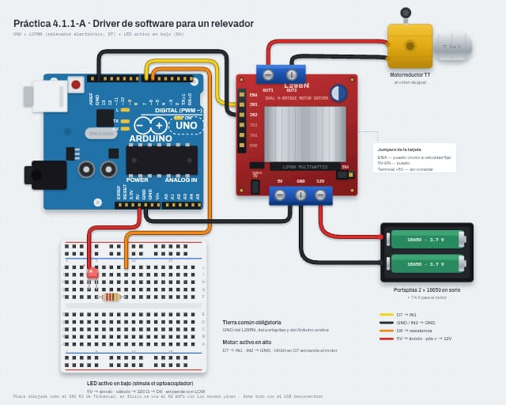
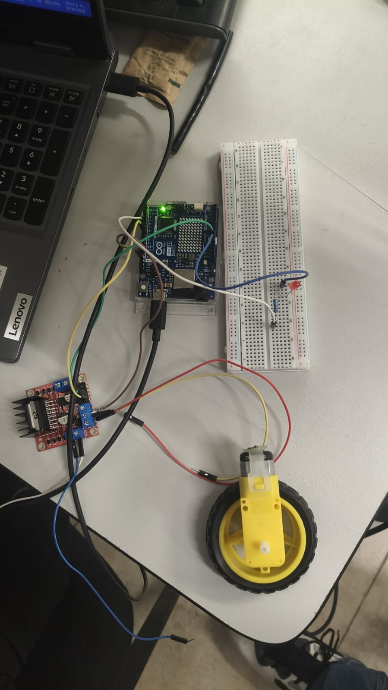

# Driver de Software para un Relevador

## Descripción

Esta práctica tiene como propósito modelar por software un relevador mediante una clase en C++ que encapsula su estado, sus órdenes y sus reglas de seguridad, programada en un Arduino UNO R4 WiFi.

Como no se cuenta con un módulo de relevadores, se utilizan dos actuadores que lo representan: un canal del puente H L298N con un motorreductor, que actúa como "relevador electrónico" (solo enciende y apaga) y se activa con nivel alto, y un LED conectado "al revés" que imita al optoacoplador de un módulo de relevador real y se activa con nivel bajo. La misma clase `Relevador` controla ambos, resolviendo internamente la lógica activo en alto / activo en bajo.

La clase impone un tiempo mínimo de 1000 ms entre cambios, medido con `millis()` (sin `delay()`), y garantiza que al iniciar o reiniciar el sistema la carga quede apagada. Las órdenes se envían desde el Monitor Serie con los comandos `M1`, `M0`, `L1`, `L0` y `E`.

## Objetivos

* Abstraer el comportamiento de un dispositivo físico en un modelo de software con estados, órdenes y restricciones.
* Aplicar encapsulamiento en C++ para proteger el hardware de órdenes incorrectas.
* Distinguir la lógica "activo en alto" de la "activo en bajo" y resolverla dentro del software.
* Implementar una regla de tiempo mínimo entre cambios con `millis()`, sin usar `delay()`.
* Garantizar un estado seguro (apagado) al energizar o reiniciar el sistema.
* Reconocer la necesidad de separar la parte de señal (Arduino) de la parte de potencia (fuente del motor).

## Herramientas y material utilizado

* Arduino UNO R4 WiFi y cable USB-C.
* Arduino IDE.
* Módulo puente H L298N.
* Motorreductor DC (tipo TT, 3–6 V).
* 2 pilas 18650 con portapilas en serie (≈ 7.4 V).
* LED (cualquier color).
* Resistencia de 220 Ω.
* Protoboard.
* Cables jumper macho-macho y macho-hembra.

## Diagrama

El diagrama muestra las conexiones de la parte de potencia (portapilas, L298N y motorreductor) y de la parte de señal (D7 hacia IN1 y LED activo en bajo en D6).

| Conexión | Descripción |
|---|---|
| Positivo del portapilas → +12V del L298N | Alimentación del motor |
| Negativo del portapilas → GND del L298N | Tierra de potencia |
| GND del L298N → GND del Arduino | Tierra común (obligatoria) |
| Motorreductor → OUT1 y OUT2 | Carga |
| D7 → IN1 del L298N | Señal de control (activo en alto) |
| IN2 del L298N → GND | Un solo sentido de giro |
| 5V → ánodo del LED | Pata larga |
| Cátodo → 220 Ω → D6 | LED activo en bajo |

Se dejan puestos los jumpers de ENA y 5V-EN del L298N.

> ⚠️ Nunca alimentes el motor desde el pin 5V del Arduino, no conectes la terminal +5V del L298N al Arduino, revisa la polaridad del portapilas y arma todo con el USB desconectado.





[Ver carpeta Diagramas](DIAGRAMA)

## Código

El programa define la clase `Relevador` con los datos privados `pin`, `activoEnBajo`, `encendido`, `ultimoCambio` y `tiempoMinimo`, y los métodos públicos `iniciar()`, `encender()`, `apagar()` y `estaEncendido()`. Se crean dos objetos de la misma clase: uno para el motor (D7, activo en alto) y otro para el LED (D6, activo en bajo).

El programa principal nunca usa `digitalWrite()` directamente: todo pasa por la clase, que decide si escribe HIGH o LOW. Si una orden se rechaza por no haber transcurrido el tiempo mínimo, el pin no cambia. Los comandos del Monitor Serie (9600 baudios) son:

| Comando | Acción |
|---|---|
| `M1` / `M0` | Encender / apagar el motor |
| `L1` / `L0` | Encender / apagar el LED |
| `E` | Mostrar el estado de ambos |

[Ver código](CODIGO/PRAC20_10_copy_20261020220037.ino)

## Reporte

El reporte contiene la explicación del funcionamiento del sistema, el diagrama de estados del relevador, la especificación de la clase, las pruebas realizadas, las respuestas a las preguntas de reflexión y las conclusiones obtenidas durante la práctica.

[Ver Reporte](REPORTE/Reporte_Relevador1.pdf)

## Resultados

La lógica de la clase se verificó compilando el código en una computadora con funciones simuladas de Arduino. Al iniciar, D7 quedó en LOW (motor apagado) y D6 en HIGH (LED apagado); la orden `M1` puso D7 en HIGH; una orden `M0` enviada 200 ms después fue rechazada sin modificar el pin, y la misma orden a los 1100 ms fue aceptada; `L1` puso D6 en LOW, encendiendo el LED.

El comportamiento esperado de las pruebas sobre el circuito armado es:

| Prueba | Resultado esperado |
|---|---|
| Funcionamiento normal | Cada orden responde con su mensaje y el motor y el LED cambian de estado. |
| Seguridad 1: `M1` y `M0` muy seguidos | `M1` se acepta y `M0` se rechaza con "Orden rechazada: espere 1 s entre cambios". |
| Seguridad 2: encender el motor y presionar RESET | Al reiniciar, el motor y el LED quedan apagados. |
| Inversión: LED creado como "activo en alto" | El LED quedaría encendido al arrancar y las órdenes `L1`/`L0` actuarían al revés. |

Salida esperada en el Monitor Serie:

```
Sistema listo. Comandos: M1 M0 L1 L0 E
Motor: APAGADO | LED: APAGADO
Motor ENCENDIDO
Orden rechazada: espere 1 s entre cambios
Motor APAGADO
LED ENCENDIDO
Motor: APAGADO | LED: ENCENDIDO
```

## Video

El video muestra el funcionamiento del sistema, incluyendo el control del motor y del LED desde el Monitor Serie, el rechazo de órdenes demasiado seguidas y el estado apagado tras presionar RESET.

[Ver video](https://youtu.be/mZbQ39qVDyE?si=aUvcpcWcf0oOTad5)

## Conclusiones

Modelar el relevador como una clase permitió concentrar en un solo lugar el estado del actuador, la traducción de la orden al nivel de pin y las reglas de seguridad, de modo que el programa principal solo usa órdenes con significado: encender y apagar.

Resolver dentro de la clase la lógica activo en alto / activo en bajo permitió controlar con el mismo código un motor y un LED que se activan con niveles opuestos, y hace que cambiar el L298N por un módulo de relevador real se limite a modificar los parámetros al crear el objeto. La regla del tiempo mínimo, implementada con `millis()`, protege al actuador de conmutaciones demasiado rápidas sin impedir que el programa siga atendiendo el Monitor Serie.

Finalmente, la práctica reforzó la separación entre la parte de señal (Arduino) y la de potencia (portapilas y L298N), así como la necesidad de una tierra común entre ambas.
